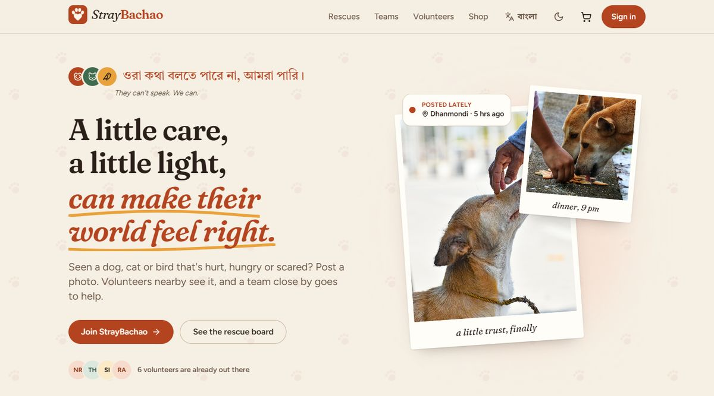
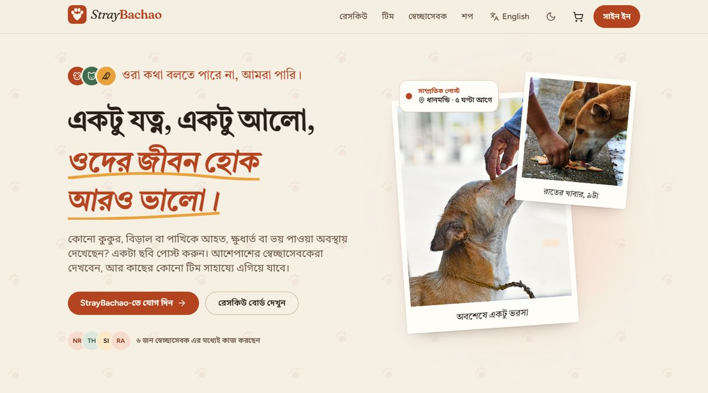
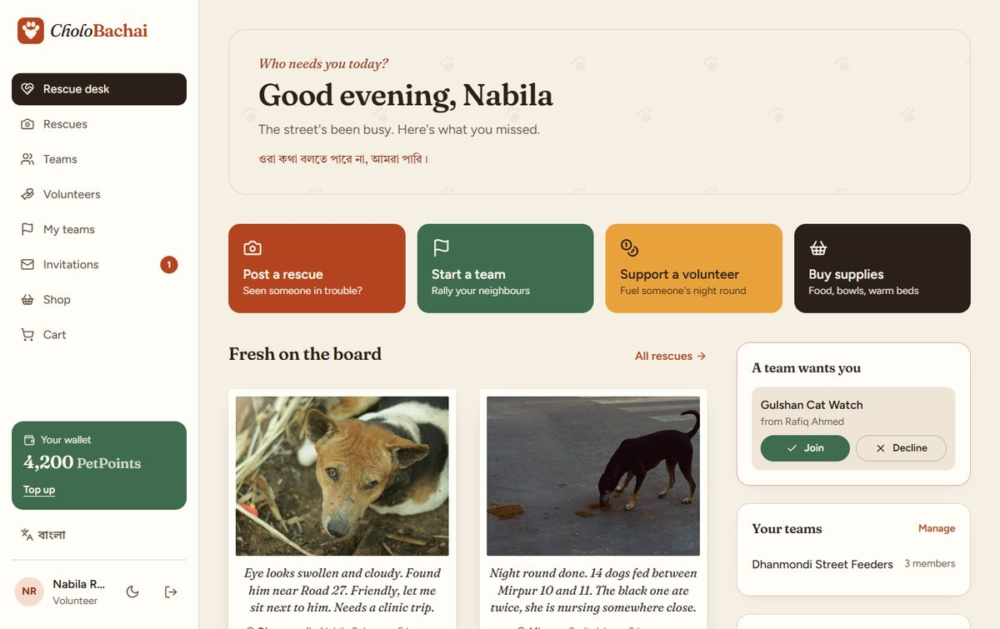
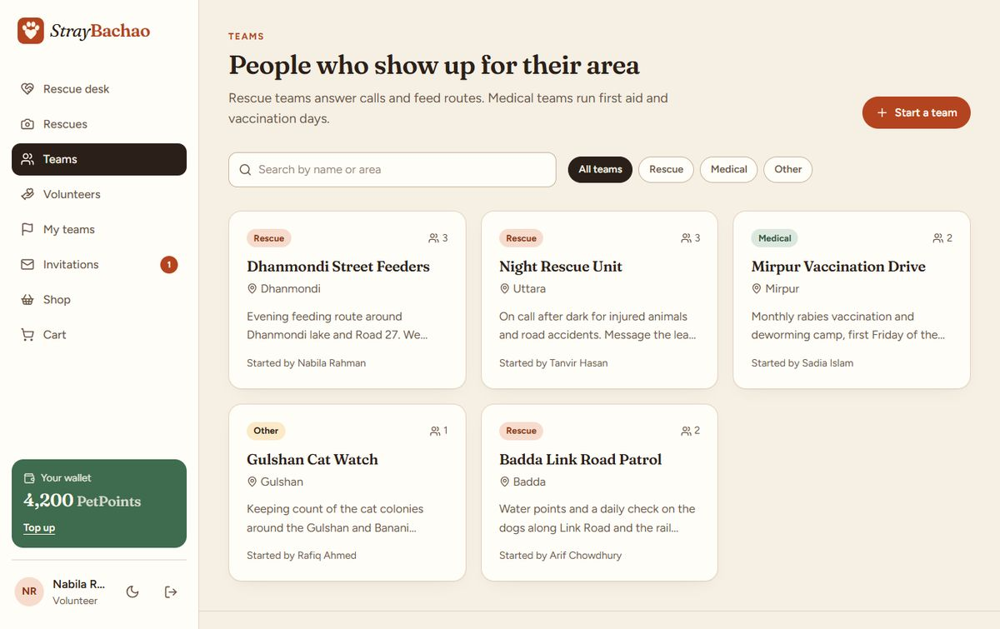
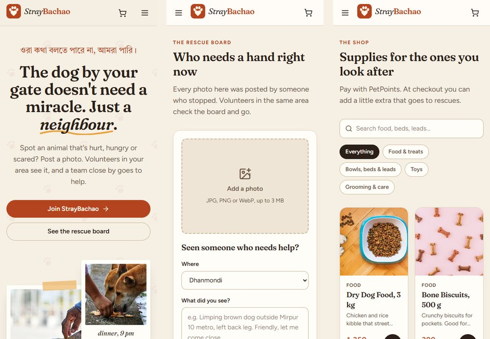

# StrayBachao: An Animal Rescue Network

*ওরা কথা বলতে পারে না, আমরা পারি।* They can't speak. We can.

*একটু যত্ন, একটু আলো, ওদের জীবন হোক আরও ভালো।*

StrayBachao connects people who spot a street animal in trouble with volunteers
nearby. Anyone can post a photo to the rescue board; volunteers form teams by
area (feeding routes, night rescues, vaccination camps) and keep a log of what
they did. Supporters top up an in-app credit called PetPoints, which they can
send to a volunteer or spend in a small supplies shop, with an optional extra
for rescues at checkout. An admin runs the shop and sees orders and revenue.

It started life as **Save Paws**, a personal project. I came back to it twice:
once to fix the backend, and once to rename it and rebuild the interface. Both
passes are written up [below](#what-changed-and-why).

| English | বাংলা |
|---|---|
|  |  |

## Stack

| Layer | What I used |
|---|---|
| Frontend | React 19, Vite, Tailwind CSS 4, React Router 7, Axios, react-toastify, lucide-react |
| State | React Context (app state and dark mode), no Redux |
| Backend | Node, Express 5 (ESM), Mongoose 8 |
| Auth | JWT in an httpOnly cookie, bcryptjs, a lockout after five wrong passwords |
| Photos | Multer in memory, checked by their first bytes, stored in MongoDB |
| Tests | Vitest against the real server process and `mongodb-memory-server`, plus a Playwright browser check |

## What it does

- **Rescue board.** Post a photo (JPG, PNG or WebP, up to 3 MB) with the area
  and a note. The board filters by area and every post links to the volunteer
  who made it.
- **Teams.** Volunteers start a team for an area, invite other volunteers, and
  post short updates to a team log. Invitations can be accepted or declined
  from the dashboard.
- **Volunteers.** A public directory searchable by area, with each volunteer's
  profile, bio and rescue posts. Signed-in users can send them PetPoints.
- **Rescue desk.** After signing in, the home page becomes a dashboard: quick
  actions, the latest posts, your teams, waiting invitations and the
  volunteers with the most PetPoints.
- **Shop.** Categories, search, stock that is checked again when you open the
  cart, and a checkout paid in PetPoints with an optional donation.
- **Admin.** Product and stock management, order status, the volunteer list
  and revenue, cost and profit charts.
- **Bangla and English.** One button switches every screen, including numbers,
  area names and "5 hrs ago". What people write (captions, team names, bios,
  team updates) is never translated: a post written in Bangla stays in Bangla.
- **Light and dark themes**, a layout that works down to 390 px, and every text
  colour checked against WCAG AA.

| | |
|---|---|
|  |  |



## Running it on Windows

The quick way is `RUN-StrayBachao.bat` in the project folder. It checks for
MongoDB on `127.0.0.1:27017`, installs packages, writes `backend/.env` with a
random JWT secret, loads the demo data the first time, and opens the API and
the site in two windows (<http://localhost:5175>).

To do it by hand you need **Node 20+** and a **MongoDB** you can connect to,
either a local install or a free Atlas cluster.

**1. Backend**

```bash
cd backend
```

```bash
npm install
```

```bash
copy .env.example .env
```

Open `backend/.env` and set `MONGODB_URI` and `JWT_SECRET`. To make a secret:

```bash
node -e "console.log(require('crypto').randomBytes(32).toString('hex'))"
```

**2. Demo data**

```bash
npm run seed
```

This clears the database and loads 9 people, 5 teams with their logs, 10
rescue posts with photos, 12 products and 8 orders. The logins:

| Role | Email | Password |
|---|---|---|
| Admin | `admin@straybachao.com` | `Admin@1234` |
| Volunteer | `nabila@straybachao.com` | `Volunteer@123` |
| Supporter | `mehedi@straybachao.com` | `Donor@1234` |

Nabila has a team invitation waiting, so the invite flow can be tried straight
away.

**3. Start the API** (<http://localhost:4000>)

```bash
npm run dev
```

**4. Frontend**, in a second terminal

```bash
cd frontend
```

```bash
npm install
```

```bash
npm run dev
```

Open <http://localhost:5173>. If you use a different port, add it to
`CLIENT_URL` in `backend/.env` so the API accepts the cookie from it.

## Tests

**Backend**, 66 tests:

```bash
cd backend
```

```bash
npm test
```

They start the real `server.js` against an in-memory MongoDB and cover
authorization, orders, stock and points under concurrent requests, photo
uploads, team and invitation rules, and the login lockout. No `.env` needed.

**Browser**, with the API, the site on port 5175 and freshly seeded data:

```bash
pip install playwright
```

```bash
python tools/browser_checks.py
```

It signs in as a visitor, a volunteer, a supporter and the admin and follows
every link: 14 to 18 pages each, with no console errors or failed requests. It
checks about 2,500 pieces of text against WCAG AA in both themes, checks that
no page scrolls sideways at 390 px, then does the same again with the site in
Bangla, and saves screenshots to `tools/out/`.

## Project layout

```
backend/
  controllers/   one file per feature area
  routes/        express routers, mounted in server.js
  models/        mongoose schemas
  middleware/    userAuth (JWT + role lookup), adminAuth (role check)
  utils/         multer config, photo check, regex escaping
  seed-photos/   the demo rescue photos
  tests/         vitest suites + the server/mongo harness
  seed.js        demo data
frontend/
  src/pages/       one file per screen
  src/components/  the layout, shared pieces, and the admin screens
  src/context/     AppContext, DarkmodeContext, LangContext
  src/i18n/        en.js and bn.js, every piece of interface text
  public/img/      landing and shop photos
tools/
  browser_checks.py
```

## What changed, and why

### First pass: the backend

Going back through it properly, a fair bit was worse than I remembered:

- **No admin authorization existed.** `adminAuth` read `req.user.role`, but
  `userAuth` only ever set `req.userId`, and the router using it was never
  mounted. Product create, update and delete worked without logging in.
- **Any user could make themselves an admin** by sending `{"role":"admin"}` to
  the profile update, which passed `req.body` straight to Mongoose.
- **Multi-item orders only charged for the last item**, and silently dropped
  donations. Negative quantities credited the buyer.
- **Two orders at the same moment could spend the same points twice, or both
  take the last item in stock.** Stock and points are now taken with
  conditional updates ("only if there is enough") and given back if a later
  step fails. Donations to volunteers had the same race; a test sends eight at
  once to prove it.
- **The saved cart never worked**, admin profit always equalled revenue, and
  dark mode did nothing.
- **Rescue photos were saved to the server's disk**, which free hosts wipe on
  every restart, and only the file extension was checked. They are now kept in
  MongoDB and checked by their first bytes, so a script renamed to `.png` is
  refused.
- **Sign in said whether an email was registered**, and had no limit on
  guesses. It now gives one message for both and locks an email for 15 minutes
  after five wrong passwords.
- Removed rather than finished: an OTP flow with an inverted guard and no UI,
  an unattached socket.io server, a "coming soon" payment page, a duplicate set
  of invite endpoints (one let anyone join any team), and an unused admin
  router.

### Second pass: the name and the interface

The old front page claimed "5,000+ animals rescued" and "$250K raised", listed
GPS tracking and chat that never existed, and linked to three pages that were
not there. The banner photo had real, recognisable people in it, and the shop
used product photos copied from Amazon listings. So:

- **Renamed to StrayBachao** everywhere, from the page title to the seed emails.
- **Rebuilt every screen** on one set of colour tokens: warm paper, clay and
  moss, Fraunces for headings, Figtree for text and Tiro Bangla for the Bangla
  lines. Visitors get a public site; signed-in users get a sidebar and the
  rescue desk.
- **The numbers on the landing page are counted** from the database by a new
  `/api/stats` route. Nothing on the site is a made-up figure.
- **All photos replaced** with free-licence ones (credits below) and the shop
  catalogue rewritten to match them.
- **Front-end bugs fixed on the way**: the admin guard trusted a role saved in
  `localStorage`; products were cached in the browser forever, so prices and
  stock went stale; a buy-now order emptied the whole cart; the team page tried
  five guessed URLs; the donate form showed to signed-out visitors; profile
  edits to email and role were silently ignored; the login logo linked to
  `localhost:5173`; "Log out" in the admin panel did not log out; and a visitor
  loading any page caused a 401 in the console.
- **Bangla alongside English**: every label, message and error the site shows
  lives in `frontend/src/i18n/en.js` and `bn.js`, and the API's English error
  messages are translated on the way in.
- **Smaller bundle**: the admin screens load only when an admin opens them,
  which took the main script from 615 kB to 400 kB.

## Known limitations

- **Top-ups are simulated.** Adding PetPoints asks for a bKash number but no
  payment happens; the amount is validated and capped at 10,000.
- **The login lockout lives in memory**, so it resets when the server restarts
  and would not be shared across several servers.
- **`npm run lint` still reports errors in the admin screens**, mostly unused
  variables in the revenue page. The pages I rewrote have none.
- **Product images are URLs typed into the admin form**, not uploads.
- The admin screens' tables and charts are still English only; their sidebar
  switches language with the rest.
- There are no component tests; the browser check covers the pages end to end
  instead.

## Photo credits

All photos are from [Unsplash](https://unsplash.com) under the Unsplash License.
Thanks to @sian_labay_official, @mpd33p, @alexandermassph, @rafatulux,
@mainulbmd, @tarikulxraana, @emon224, @theaminalizadeh, @parastoo_gh,
@jtrinh_artwork, @hemangpatel, @kristinwilson, @raditahmed6, @kolithaheshan,
@aalochak, @hypethat, @okeykat, @mattycoulton, @koalink, @jordanbigs,
@brettwharton, @goldencoastlife, @feliciamontenegro, @pozva, @moob, @alfredl
and @neakasa.
